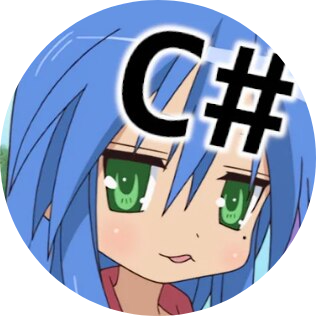

<a href="README.md">
  
</a>
<a href="README-TR.md">
  
</a>

  <br />
  <br />

<div align="center">
  
  <br />
  <br />

  <p>
     10. sınıfta Nesne Tabanlı Programlama dersi için yazdığım ilk C# programlarım.
  </p>


  <p>
    <a href="#about">Hakkında</a> •
    <a href="#tech">Teknolojiler</a> •
    <a href="#setup">Kurulum</a>
  </p>

  <br />
  <br />
</div>


## <a id="about"></a> 📋 Hakkında

Bu uygulamaların hepsini 10. sınıfta, ders kitabına bakarak yazılıma ilk başladığım zamanlarda okulda yapmıştım. O zamana kadar hayatımda neredeyse klavyeye bile dokunmamıştım. Üzerinden yaklaşık 4 yıl geçmiş. Bir anı ve arşiv olarak burada kalsın istedim.

Depoda Nesne Tabanlı Programlama dersinden 88 küçük C# projesi var. Çoğu ders kitabının ilk iki ünitesindeki alıştırmalar, geri kalanı ise öğretmenlerimizin sınıfta yaptırdığı sözlü uygulamalar. Her proje ayrı bir Visual Studio çözümüdür.

İlk ünitede Windows Forms'un temel kontrolleriyle basit hesaplamalar, ikinci ünitede karar yapıları ve döngüler var. Sözlü uygulamalar ise çoğunlukla sınıflar, kalıtım, soyut sınıflar ve arayüzler üzerine konsol uygulamaları.

## <a id="tech"></a> 🛠️ Teknolojiler

`C#` · `.NET Framework` · `Windows Forms` · `Visual Studio`

## <a id="setup"></a> 🚀 Kurulum

### Gereksinimler

- **Windows**
- **Visual Studio**
- **.NET Framework 4.5.2 ve 4.8** geliştirici paketleri

### Adım Adım Kurulum

1. **Depoyu klonlayın**

   ```bash
   git clone https://github.com/xkintaro/nesne-tabanli-programlama.git
   cd nesne-tabanli-programlama
   ```

2. **Bir proje açın**

   Çalıştırmak istediğiniz projenin klasörüne gidin ve `.sln` dosyasını Visual Studio ile açın.

3. **Projeyi çalıştırın**

   Projeyi derleyip başlatmak için Visual Studio'da `F5` tuşuna basın.

#

<p align="center">
  <sub>❤️ Developed by "Mustafa TAŞAL" (kintaro)</sub>
</p>
