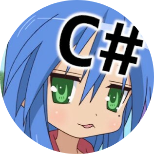
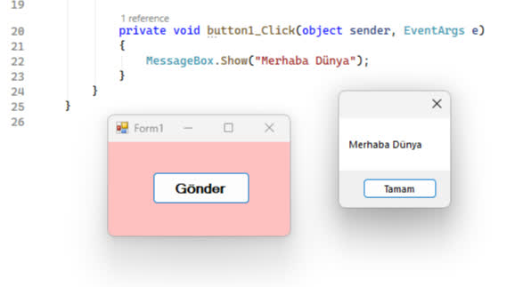

<a href="README.md">
  
</a>
<a href="README-TR.md">
  
</a>

  <br />
  <br />

<div align="center">
  
  <br />
  <br />

  <p>
     My first C# programs, written in 10th grade for an object-oriented programming class.
  </p>


  <p>
    <a href="#about">About</a> •
    <a href="#tech">Tech</a> •
    <a href="#setup">Setup</a> •
    <a href="#gallery">Gallery</a>
  </p>

  <br />
  <br />
</div>

## <a id="about"></a> 📋 About

I built all of these back in 10th grade at school, when I first started coding by following a textbook. I had barely even used a keyboard before that. It’s been almost 4 years now. Keeping this here as a memory and an archive.

The repository holds 88 small C# projects from my Object-Oriented Programming class. Most of them are textbook exercises from the first two units, and the rest are oral exercises our teachers had us do in class. Each project is a separate Visual Studio solution.

The first unit covers simple calculations with the basic Windows Forms controls, and the second unit covers decisions and loops. The oral exercises are mostly console applications on classes, inheritance, abstract classes, and interfaces.

## <a id="tech"></a> 🛠️ Tech

`C#` · `.NET Framework` · `Windows Forms` · `Visual Studio`

## <a id="setup"></a> 🚀 Setup

### Requirements

- **Windows**
- **Visual Studio**
- **.NET Framework 4.5.2 and 4.8** developer packs

### Step-by-Step Installation

1. **Clone the repository**

   ```bash
   git clone https://github.com/xkintaro/nesne-tabanli-programlama.git
   cd nesne-tabanli-programlama
   ```

2. **Open a project**

   Open the folder of the project you want to run and open its `.sln` file in Visual Studio.

3. **Run the project**

   Press `F5` in Visual Studio to build and start the project.

## <a id="gallery"></a> 🖼️ Gallery



#

<p align="center">
  <sub>❤️ Developed by "Mustafa TAŞAL" (kintaro)</sub>
</p>
